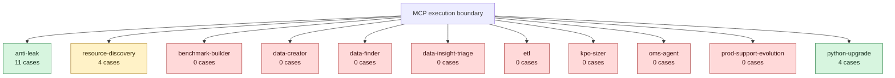

# Data-engineering agent benchmark coverage

This diagram records the public benchmark case count for each top-level agent
package. MCP tools warn when an invoked agent has fewer than three cases.
Agents with more than three cases are highlighted as thoroughly exercised;
exactly three meets the warning threshold but is shown separately.

Counts are derived from public `cases.yaml` files beneath
`src/workspaces/data_engineering/benchmarks/`, excluding `deprecated/`. Update
this diagram when cases or top-level agent packages are added or removed.

`production-support` is no longer listed here. It migrated to
`workflows/prod_support/` and is driven by the harness through the
`production-support` skill, so it is not an agent package. Its handoff cases
were deprecated with the in-process orchestrator they scored and remain as
source data under `benchmarks/deprecated/production_support/`.
