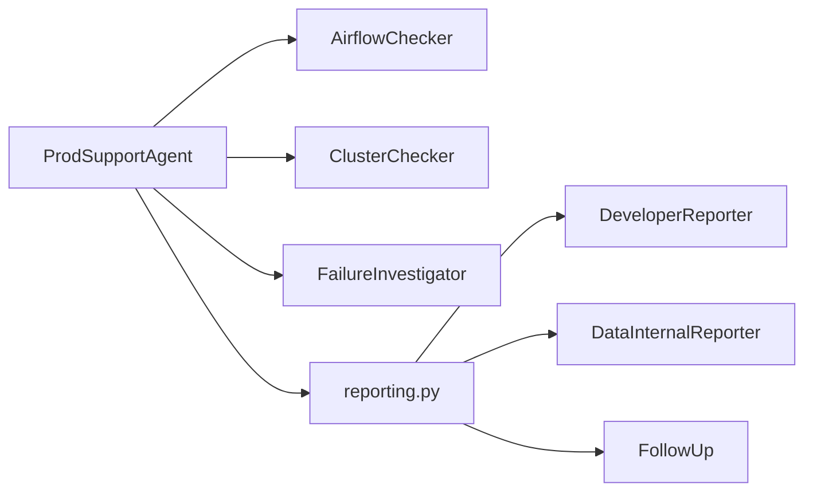

# Production-support agent

## Purpose

The production-support agent discovers recent Airflow failures, retrieves exact
task logs, classifies each failure deterministically, and produces a read-only
operational report. It accepts an `AgentRequest` and returns an `AgentResult`;
it never retries jobs or mutates production systems.

## Architecture

[`agent.py`](agent.py) is a thin orchestration and composition entry point.
[`airflow_checker.py`](airflow_checker.py) owns failure discovery, operational
window filtering, regional selection, deduplication, and deterministic ordering.
[`cluster_checker.py`](cluster_checker.py) coordinates concurrent US and CA
health reads, while [`cluster_health.py`](cluster_health.py) owns the immutable
health model and evidence-derived state.

[`developer_reporter.py`](developer_reporter.py),
[`data_internal_reporter.py`](data_internal_reporter.py), and
[`follow_up.py`](follow_up.py) independently render their audience contracts.
[`report_findings.py`](report_findings.py) supplies the reporters with one
immutable, fail-closed set of diagnoses, identities, configuration, and health.
[`reporting.py`](reporting.py) assembles those outputs with shared report
metadata and URLs. [`reporting_channel.py`](reporting_channel.py),
[`reporting_health.py`](reporting_health.py), and
[`reporting_validation.py`](reporting_validation.py) provide focused formatting
and fail-closed validation. [`reporting_details.py`](reporting_details.py) owns
client identity extraction and grouping, and
[`reporting_config.py`](reporting_config.py) defines typed Data Internal
omission groups.

[`dates.py`](dates.py) resolves operational windows, [`models.py`](models.py)
owns immutable domain values, and [`classification.py`](classification.py)
maps log evidence to diagnoses. [`investigation.py`](investigation.py) races
exact Spark evidence, uses bounded same-task history, and caps investigation
parallelism at five. [`evidence.py`](evidence.py) reduces exact logs to bounded
excerpts. [`datasets.py`](datasets.py) supports capture and deterministic replay.

External access is isolated by the protocols in `ports.py`. `workloads.py` and
`oms.py` validate workload routing and OMS query construction. `tools.py`
describes the agent-visible tools, and `evaluation.py` scores benchmark
outcomes. The package public API is exported deliberately from `__init__.py`.
The `.codex/skills/prod-support` symlink exposes the canonical compact
production-support message contract maintained in `pl-data-plugins`.

Airflow discovery and the `ClusterChecker` start concurrently; the injected
Airflow source owns its regional I/O parallelism and the `ClusterChecker` owns
parallel US and CA health reads. Failure and Resource Discovery work uses a
shared semaphore with configurable parallelism from one through five; values
above five are rejected. Each failure remains independent and shared mutable
state is not used.

## Dependencies

- `domain`: framework-neutral agent request, result, and definition contracts.
- `AirflowFailureSource`: injected protocol for failure discovery and exact log
  retrieval.
- `PriorTaskLogSource`: optional bounded same-DAG/same-task fallback when the
  latest exact log is unavailable or non-diagnostic.
- `AirflowTaskMetadataSource` and `OmsJobEvidenceSource`: optional exact
  workload inspection and Spark corroboration dependencies.
- `ClusterHealthSource`: optional current application, pod, DAG parsing, and
  KEDA observations for both regions.
- `ResourceDiscoveryInvoker`: injected agent boundary used to resolve unique
  resend clients through the read-only Resource Discovery agent.
- Production MCP composition: injects the genuine Resource Discovery API
  adapter only in explicit production mode and fails on missing credentials.
- Production MCP reporting configuration: accepts validated omission-group
  names and exposes the KPO sizing agent URI without invoking that agent.
- Airflow and OMS: external read-only evidence systems reached through adapters
  outside this package.
- Runtime configuration: supplied by the selected adapters; the domain agent
  reads no credentials or environment variables directly.

## Workflow

1. Resolve the requested date relative to the injected clock.
2. Start `AirflowChecker` and `ClusterChecker` concurrently. Airflow discovery
   queries configured regions in parallel, then the checker enforces the
   exclusive 05:00 UTC window end and deterministic deduplication.
3. Deduplicate failures and investigate them with at most five workers.
4. Resolve every client UUID found in a DAG or task identifier through Resource
   Discovery before triage.
5. Fetch an exact task log for every failure, even when discovery includes a
   non-empty excerpt.
6. Classify each hydrated failure from its full log. If evidence is unavailable
   or non-diagnostic, inspect at most five prior attempts of the exact same DAG
   and task. For a proven Spark workload, start exact Airflow and OMS reads
   concurrently and cancel pending OMS work when Airflow proves a timeout.
7. Retain at most three diagnostic lines plus source, status, and original
   character count. Never infer OOM from exit `-9` without memory evidence.
8. Pass the same validated findings to `DeveloperReporter`,
   `DataInternalReporter`, and `FollowUp`. Group clients that failed on the same
   job. Investigate every failure, but default-omit D2P, MI3, subscriber,
   maintenance, backfill, and CMM groups from Data Internal.
9. Split Data Internal bullets only when required to remain within 180
   characters. Keep differing Developer evidence paired with its client/job.
10. Generate an actions-only, suggestion-only follow-up; never perform retries
   automatically. Configured omissions do not receive rerun suggestions.
11. For controller-led execution, frame the report and 05:00 UTC window first,
   then start US failure discovery, CA failure discovery, and regional cluster
   health concurrently.
12. Emit raw ISO-8601 regional failure links and one bounded grid link per failed
   DAG without percent-encoded or locale-specific timestamps.
13. Preserve every discovered failure and exact-log lookup in the execution
    trace, and include every failure in the Developer report.
14. Verify prior-log fallback, concurrent Spark evidence, timeout cancellation,
    resend routing, escalation, and channel filtering before final delivery.
15. Hard-gate resend application selection on a reviewed production mapping;
   report unresolved routing rather than deriving it from logs or subdomains.
16. Trigger Resource Discovery for every unique client UUID found in a DAG or
    task identifier before triage.
17. Keep raw UUIDs, Spark IDs, and record references out of audience messages.
18. Render compact `URLs to validate`, `Message for developer:`, and regional
    Data Internal blocks without Markdown section headings, blank lines between
    bullets, or periods in Data Internal. Never mix findings between US and CA.
    Group clients by shared failed job and group multiple jobs for one client,
    using resolved names with three-character UUID prefixes.
19. Put regional failure and DAG-grid links in `URLs to validate`, not in
    Developer bullets. Emit US and CA health first; derive overall status from
    primary checks, while access gaps and retired replicas remain warnings.
    Reject duplicate health observations or incomplete failure diagnoses.
20. Render `Follow Ups:` with only Resource Discovery-linked resend choices and
    approval-gated, job-grouped rerun choices. Escalate resends above 100 events
    to `pd-rix`; for a non-omitted job above five attempts, retain rerun approval
    and link the `agent://kpo-sizer/definition` interface without invoking it.
21. Treat `validate_event_bus_opportunities` as missing-snapshot validation and
    keep its Data Internal wording concise. Preserve proven timeout, OOM, and
    distinctness-validation labels because they are operationally important.
22. Return the reports, follow-up, correlation ID, tool names, and operational
    attributes.
23. In explicit CLI debug mode, capture and redact production Airflow evidence
    once, replay from that snapshot, and scaffold only unscored `captured`
    benchmark metadata with empty expectations.

Invalid dates, non-404 log failures, and invalid query parameters fail
immediately with specific exceptions. A task-log HTTP 404 is recorded as an
explicit developer-report evidence gap only after bounded same-task fallback
finds no terminal evidence. Explicit Resource Discovery
`prod_support_ignore=true` metadata removes reviewed canaries after identity
resolution. Normal execution has no externally visible write effects.

## Verification

Unit tests under `tests/unit/workspaces/data_engineering/agents/` cover dates,
classification, OMS routing, reporting, and workload behavior. Integration tests
exercise Airflow adapters, and production-support benchmark cases verify the
complete report contract. Opt-in production integration tests authenticate and
issue bounded, read-only failure queries independently against the US and CA
Airflow APIs and can verify a genuine Resource Discovery lookup.

## Change policy

Update this document when modules, public contracts, injected dependencies,
concurrency, evidence routing, failure behavior, or side-effect boundaries
change.
