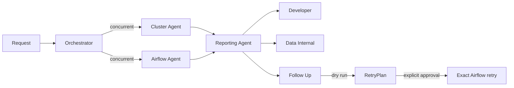

# Production-support agent

## Purpose

The production-support system performs read-only US and CA operational checks.
It accepts a generic, US-only, or CA-only request with an optional date,
defaults to the prior operational day, and returns validation links, a
Developer message, a Data Internal report, and suggestion-only follow-up.
The investigation never retries jobs, resends events, or mutates production.
The separate Follow Up Agent can retry exact failed Airflow task instances only
after a dry run and explicit approval.

## Architecture

[`agent.py`](agent.py) is the orchestrator. It resolves the date through
[`dates.py`](dates.py), resolves US/CA scope through [`scope.py`](scope.py), and
starts the selected cluster and Airflow paths concurrently.

[`cluster_checker.py`](cluster_checker.py) is the non-delegating Cluster Agent
boundary. It calls the injected `ClusterHealthSource` concurrently for selected
regions. [`cluster_health.py`](cluster_health.py) stores pod readiness, restart
count, KEDA state, warnings, and derived health.

[`airflow_checker.py`](airflow_checker.py) is the non-delegating Airflow Agent
boundary. Regional sources are queried concurrently, then failures are
deduplicated and filtered to the operational window. Its handoff also carries
Airflow DAG-processor health and active DAG counts for every selected region;
these values come from Airflow health and DAG inventory, not failed-task
counts. D2P and MI3 failures that match configured omissions still use
[`investigation.py`](investigation.py) to retrieve compact exact evidence. They
collapse to omission codes only after the source verifies a success for the
same DAG and task inside the operational window.

[`reporting.py`](reporting.py) builds deterministic drafts and validation links.
[`report_agents.py`](report_agents.py) owns one model-backed Reporting Agent
that formats Developer, Data Internal, and Follow Up in a single JSON response.
It receives compact diagnoses rather than raw logs. Its Follow Up input is
deterministic and immutable: the Reporting Agent must copy it exactly, and the
orchestrator must return the complete Reporting output verbatim. Data Internal
reporters put regional omission codes on the final detail line. Deterministic
reporting remains available when no runtime is injected.

[`component_agents.py`](component_agents.py) contains concise Cluster and Airflow
agent definitions. [`tools.py`](tools.py) contains their existing read-only tool
metadata. [`reporting_config.py`](reporting_config.py) owns typed omission
configuration. The MCP adapter persists it at
`~/.prod_support/omissions.json` through setup, read, write, and conversational
add/remove tools. The combined report renders represented codes in a separate
linked `Omitted Jobs` section.

[`retry_agent.py`](retry_agent.py) is the Follow Up Agent. It maps regional,
all-jobs, and numbered include/exclude directions to immutable retry batches.
[`retry_models.py`](retry_models.py) contains the plan contracts. The production
Airflow adapter first calls the clear endpoint with `dry_run=true`, requires the
returned task instances to match exactly, and executes only the same plan after
an approval ID is supplied. Upstream, downstream, past, and future tasks remain
disabled, and immediate task state is read back after execution.

[`datasets.py`](datasets.py) captures scoped, redacted Airflow evidence,
including exact logs and bounded same-task success verification for omission
candidates. Benchmark-side
`production_support/collection.py` starts Cluster and Airflow collection
concurrently, adds reviewed Resource Discovery metadata, and writes compact
evidence plus the direct Reporting input. Debug mode replays all captured
sources instead of querying production twice.

Only the top-level orchestrator definition permits delegation. Cluster,
Airflow, Follow Up, and Reporting definitions are leaf agents, and the model runtime
rejects delegation-capable definitions. Regional I/O concurrency is implemented
with `asyncio`, and failure investigation uses bounded async calls rather than
agent delegation.

## Dependencies

- Internal: `domain.AgentDefinition`, immutable production-support models,
  deterministic reporters, and date/scope parsing.
- Injected protocols: `AirflowFailureSource`, optional `AirflowSuccessSource`,
  `RegionalAirflowFailureSource`, `ClusterHealthSource`,
  `ResourceDiscoveryInvoker`, exact-log and OMS evidence sources, and
  `AgentRuntime`. The Follow Up Agent additionally depends on
  `AirflowRetrySource`.
- External services: Airflow, Kubernetes/KEDA health tooling, Resource
  Discovery, and OMS through adapters outside the domain package.
- Runtime configuration: selected Airflow regions, reporting omission groups
  from `~/.prod_support/omissions.json`, credentials owned by adapters, and an
  optional model runtime.
- Side effects: the investigation is read-only. The separate follow-up execution
  tool can clear exact approved failed task instances.

## Workflow

1. Accept `Do prod support`, `Do US prod support`, or `Do CA prod support`.
   Optional supported date text is resolved by `dates.py`; otherwise the prior
   operational day beginning at 05:00 UTC is selected.
2. Resolve the regional scope once and pass it to both component agents.
3. Start Cluster and Airflow checks concurrently.
4. The Cluster Agent reports selected-region pod state, restart count, KEDA
   status, warnings, and evidence gaps. Its definition cannot delegate.
5. The Airflow Agent queries selected regions concurrently. It returns
   DAG-processor health, active DAG counts, and direct failures; its definition
   cannot delegate.
6. Resolve client identity for discovered client-scoped failures so reviewed
   support-ignore metadata still applies. When no reviewed unique identity is
   available, keep the unresolved label in evidence, ask a human to resolve the
   identity, and exclude that client from resend and rerun proposals.
7. Retrieve compact exact-log evidence for every failure. For each configured
   omission candidate, verify whether the same DAG and task succeeded inside
   the operational window. Only verified recoveries receive an `omitted`
   diagnosis; unverified candidates remain normal diagnosed failures. Raw logs
   are not passed to reporting.
8. Build deterministic validation links and audience drafts.
9. If a reporting runtime is configured, make one leaf Reporting Agent call for
   all three audience outputs. Fail closed unless Developer starts with
   `Message for developer:` and contiguous two-space bullets; Data Internal
   starts with the exclamation banner, renders selected regions in canonical
   US-then-CA order, puts exactly one `Good` or `Ongoing` status under each
   region, and uses two-space detail bullets only under `Ongoing`.
10. Put omitted codes on the last detail line in each represented Data Internal
    regional block. Add a separate `Omitted Jobs` section linking each
    represented code to `agent://prod-support/omissions`, where operators can
    ask to add or remove configured omissions. Follow Up remains last in the
    combined report and is either
    `- No action is required.` or a `- Would you like to:` list of indented,
    suggestion-only actions. Group approved resends by reviewed link and logical
    date as `Resend <count> opportunities for <clients> on <link> for date
    <MM-DD-YY>`. When the environment or reviewed link is unavailable, ask a
    human to identify the production resend application environment. Broad
    review or investigation requests are not valid Follow Up actions; cluster
    warnings remain Developer evidence unless a supported remediation exists.
11. Treat the Reporting Agent response as authoritative. The orchestrator
    returns it verbatim and must not rewrite, summarize, repair, or append to
    it. A changed deterministic Follow Up fails validation.
12. Return the selected regions and operational date in structured attributes.
13. For benchmark collection, persist one manifest-backed bundle and replay
    Airflow, cluster health, and Resource Discovery from that bundle.
14. For a later follow-up request, expose only eligible failed tasks as numbered
    candidates. Exclude resend tasks, verified omissions, and unresolved client
    identities. Preserve each candidate's source region. Convert `follow up`,
    `retry CA`, `retry all jobs`, or numbered include/exclude wording into an
    exact dry-run plan. Execute only when the caller supplies the unchanged plan
    ID and a non-empty approval ID, then return Airflow's state read-back.

Invalid dates, empty scopes, duplicate findings, invalid report JSON, and
non-404 evidence failures fail immediately with actionable exceptions.

## Verification

Focused tests in `tests/unit/workspaces/data_engineering/agents/` verify prompt
scope, date defaults, regional concurrency, omission recovery verification, restart
reporting, one-call reporting, omission placement, and production-mutation
language. Adapter tests verify regional Airflow discovery and MLflow
registration. `uv run python scripts/check.py` runs the repository quality gate.

## Change policy

Update this document when public prompt forms, scope/date semantics, component
boundaries, concurrency, omission behavior, reporting output, injected
dependencies, or production side-effect rules change.
