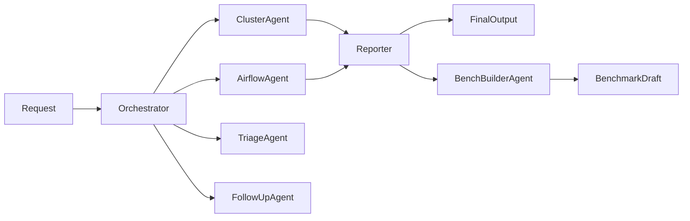

# Production-support agent

## Purpose

This package keeps the explicit prdbench agent design as the public
production-support system while retaining the operational tools from the
earlier implementation. The public graph consists of Orchestrator,
ClusterAgent, AirflowAgent, TriageAgent, FollowUpAgent, Reporter, and
BenchBuilderAgent.

The default production-support scope is US and CA for the previous operational
day beginning at 05:00 UTC. Normal investigation is read-only. FollowUpAgent
may execute exact Airflow retries only after a validated dry run and explicit
approval.

## Architecture

[`prompts.py`](prompts.py) defines every agent prompt in a function docstring.
[`definition.py`](definition.py) converts named prompts and tool assignments
into typed `AgentDefinition` values. [`suite.py`](suite.py) constructs the
public graph and is the only module that grants delegation to Orchestrator.
All operational specialists are leaf agents. BenchBuilderAgent may perform
bounded benchmark-review delegation, but total parallelism must not exceed
five.

Tool ownership is explicit:

- ClusterAgent receives the read-only cluster-health tool.
- AirflowAgent receives failure discovery, exact-log, workload, OMS,
  classification, and Resource Discovery tools.
- FollowUpAgent receives retry planning and approved retry execution tools.
- Reporter receives evidence-qualified findings and calls no investigation
  tools.
- TriageAgent is a placeholder that returns
  `Triage agent hasn't been setup.`
- BenchBuilderAgent receives completed handoffs and builds a redacted,
  review-required current-day benchmark draft.

[`workflow.py`](workflow.py) retains the deterministic operational workflow as
`ProductionSupportWorkflow`. It uses the same public Orchestrator definition
but executes the existing injected adapters and domain logic. The reusable
implementation remains split across date, scope, cluster, Airflow,
investigation, classification, reporting, retry, dataset, and port modules.
It is an internal workflow, not a second public agent.

## Dependencies

- Internal: typed agent definitions, immutable production-support models,
  deterministic reporting, handoff contracts, and benchmark builders.
- Injected protocols: Airflow discovery and retry sources, cluster-health
  source, Resource Discovery, OMS and exact-log sources, and optional model
  runtime.
- External services: Airflow, Kubernetes/KEDA, Resource Discovery, and OMS
  through adapters outside this package.
- Resource Discovery production composition prefers a unique API response and
  uses the maintained non-secret local client index when the API is empty or
  ambiguous.
- Persistent configuration: omission settings under
  `~/.prod_support/omissions.json`. New local configurations register D2P,
  MI3, Subscriber, Maintenance, Backfill, and CMM by default. Maintenance
  includes `log_cleanup` tasks such as `expire-logs-3`. MI3 and D2P may appear
  in Data Internal only as an indented shorthand detail under `- Ongoing`.
  Other configured
  omissions stay hidden there, and all configured omissions are excluded from
  Follow Up and retry candidates.
- Side effects: investigations and benchmark construction are read-only.
  Approved FollowUp execution may clear only the exact validated task
  instances in its unchanged retry plan.

## Workflow

1. `Do prod support` and `Do prod support for yesterday` route through the
   `run_prod_support` MCP tool. Orchestrator resolves US and CA plus the prior
   operational day beginning at 05:00 UTC.
2. It invokes ClusterAgent and AirflowAgent concurrently when both are needed.
3. ClusterAgent reports health per requested region with observation time and
   evidence.
4. AirflowAgent runs the baseline script, keeps one bullet per failed task
   instance, uses baseline results for omitted jobs, and performs root-cause
   analysis for non-omitted jobs. Client resolution uses unique API evidence or
   the authoritative local index; reporting shortens
   `Scotiabank - Data Validation` to `Scotiabank DV`.
5. TriageAgent returns its placeholder response when explicitly invoked.
6. Reporter receives completed findings, preserves region and client
   boundaries, surfaces contradictions, preserves underscores in job
   identifiers such as `validate_event_bus_opportunities`, keeps region labels
   fully left-aligned, renders only MI3/D2P omission shorthand, excludes all
   omissions from Follow Up, and returns the authoritative report.
7. Orchestrator serves the Reporter output without rewriting it. The MCP
   response exposes `links`, `developer_message`, `data_internal_message`, and
   an approval-only `follow_up_message`. The user-facing response presents
   those fields as Slack-friendly mrkdwn without code fences or GitHub-style
   headings.
8. FollowUpAgent creates an exact dry-run retry plan and executes it only with
   explicit approval for the unchanged plan.
9. If the request also asks to build a benchmark case, Orchestrator invokes
   BenchBuilderAgent after normal support. The MCP response keeps every normal
   production-support field and adds benchmark artifact metadata.

Invalid dates, empty scopes, malformed handoffs, unsupported parallelism,
report-contract violations, and changed retry plans fail immediately.

## Benchmark behavior

The active suite is
`benchmarks/production_support/dates/09-27-26`. It measures named-agent
invocation, parent-child attribution, exact handoff inputs and outputs,
cardinality, dependency ordering, delegation boundaries, authoritative output,
production mutation safety, benchmark quality, and MCP output continuity.

The suite was created for September 27, 2026 and evaluates the September 26
operational day. It does not retrofit removed v1 runs to the current expected
behavior.

## Verification

Tests under `tests/unit/workspaces/data_engineering/agents/` cover prompt
docstrings, tool ownership, suite structure, workflow behavior, reporting,
retry safety, and benchmark construction. Integration and end-to-end tests
cover MCP output continuity, adapters, registration, and matrix execution.

Run `uv run python scripts/check.py` before completing a change.

## Change policy

Update this document when prompts, agent boundaries, tool ownership,
delegation, operational semantics, benchmark handoffs, or side-effect rules
change.
