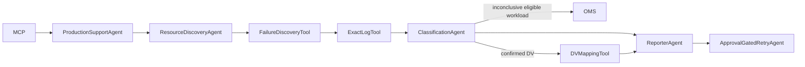

# Production-support agent

## Purpose

This package exposes a single MCP-facing `ProductionSupportAgent` that
coordinates focused agents and deterministic tools. The runtime path is
Resource Discovery, bounded failure discovery, exact-log retrieval,
classification with conclusive-evidence short-circuiting, DV mapping,
reporting, and approval-gated retry.

The prdbench Orchestrator, ClusterAgent, TriageManager, FollowUpAgent, Reporter,
and BenchBuilderAgent definitions remain available for benchmark compatibility.

The default production-support scope is US and CA for the previous operational
day beginning at 05:00 UTC. Normal investigation is read-only. A developer
follow-up authorizes immediate execution of the exact eligible Airflow retries.

## Architecture

[`agent.py`](agent.py) defines the MCP-facing `ProductionSupportAgent`.
Versioned Markdown instructions live under [`instructions/`](instructions/).
[`failure_tools.py`](failure_tools.py) owns bounded failure discovery and
exact-task log retrieval. [`classification_agent.py`](classification_agent.py)
owns evidence classification, and [`dv_mapping.py`](dv_mapping.py) maps only
proven distinctness failures to exact upstream `ra_group` tasks.

Tool ownership is explicit:

- ProductionSupportAgent coordinates the workflow and performs no direct
  production mutation.
- Resource Discovery resolves complete client UUIDs before client-scoped reads.
- FailureDiscoveryTool queries bounded failures, including an exact client DAG.
- ExactLogTool retrieves one exact task-attempt log.
- ClassificationAgent classifies the exact log and short-circuits deeper
  investigation when it is conclusive. It uses OMS only after Airflow evidence
  remains unresolved.
- DV Mapping parses every distinctness check but maps only mismatched or
  explicitly failed DatasetForms.
- Reporter receives evidence-qualified findings and calls no investigation
  tools.
- ApprovalGatedRetryAgent receives exact retry candidates. A mapped upstream
  task uses `only_failed=false`; ordinary failed tasks use `only_failed=true`.
- BenchBuilderAgent receives completed handoffs and builds a redacted,
  review-required current-day benchmark draft.

[`workflow.py`](workflow.py) retains the deterministic operational workflow as
`ProductionSupportWorkflow`. It uses the same public Orchestrator definition
but executes the existing injected adapters and domain logic. The reusable
implementation remains split across date, scope, cluster, Airflow,
investigation, classification, reporting, retry, dataset, and port modules.
[`client_investigation.py`](client_investigation.py) provides the narrower
read-only workflow behind the `investigate_client_failures` MCP tool. It
validates and resolves one complete client UUID before querying only that
client's exact `l3-main-<UUID>` DAG.
Shared OMS routing, query construction, and evidence protocols are owned by
[`../oms_agent/`](../oms_agent/); this package retains compatibility exports.
It is an internal workflow, not a second public agent.

OpenTelemetry spans mirror execution: MCP is the root, production-support
investigation is its child, delegated Resource Discovery and reporting are
children of investigation, and provider runtime calls are children of
reporting. Triage has one batch span; follow-up execution has its own agent
span.

## Dependencies

- Internal: typed agent definitions, immutable production-support models,
  deterministic reporting, handoff contracts, and benchmark builders.
- Injected protocols: Airflow discovery and retry sources, cluster-health
  source, Resource Discovery, OMS and exact-log sources, and optional model
  runtime.
- External services: Airflow, Kubernetes/KEDA, Resource Discovery, and OMS
  through adapters outside this package.
- Resource Discovery production composition prefers a unique API response and
  uses the maintained non-secret local client index when the API is empty or
  ambiguous.
- Persistent configuration: omission settings under
  `~/.prod_support/omissions.json`. New local configurations register D2P,
  MI3, Subscriber, Maintenance, Backfill, and CMM by default. Maintenance
  includes `log_cleanup` tasks such as `expire-logs-3`. All configured
  omissions stay hidden from Data Internal, Follow Up, and retry candidates.
- Optional durable memory: when the shared agent-memory PostgreSQL settings
  are configured, the workflow stores one confirmed, bounded diagnosis summary
  per exact failed task instance. Summaries contain task identity,
  classification, confidence, and evidence state only; raw logs, prompts,
  reports, and resource payloads are never stored.
- Side effects: investigations and benchmark construction are read-only.
  Approved FollowUp execution may clear only the exact validated task
  instances in its unchanged retry plan.
- Telemetry: shared OpenTelemetry API instrumentation and an SDK console
  exporter configured by the MCP composition root. W3C context may enter from
  MCP input; console JSON is written to stderr.

## Workflow

1. `Do prod support` and `Do prod support for yesterday` route through the
   `run_prod_support` MCP tool. ProductionSupportAgent resolves US and CA plus the prior
   operational day beginning at 05:00 UTC.
   `Why is <client UUID> failing?` routes through
   `investigate_client_failures`, which defaults to the prior 05:00 UTC anchor
   through the current time and accepts an explicit ISO-8601 `since` cutoff.
   It resolves the complete UUID first, sends an exact DAG filter to Airflow,
   inspects every matching failed task attempt, and returns structured
   developer evidence plus a suggestion-only follow-up.
2. It invokes cluster checks and failure discovery concurrently when both are
   needed.
3. ClusterAgent reports health per requested region with observation time and
   evidence.
4. ClassificationAgent receives every failure in one bounded batch. It first classifies
   captured failure messages, then queries exact Airflow metadata and OMS where
   applicable. It fetches detailed task logs only for unresolved failures.
   Omitted jobs do not trigger Resource Discovery. Other client resolution
   passes the complete UUID from the DAG or task identifier and rejects
   report-only three-character prefixes. It uses unique API evidence or the
   authoritative local index;
   reporting shortens
   `Scotiabank - Data Validation` to `Scotiabank DV`.
5. ReporterAgent receives completed findings and may refine only the Developer
   message. Data Internal and Follow Up remain the verbatim deterministic
   drafts, preserving region and client boundaries, underscores in job
   identifiers such as `active_deposit_accounts` without converting them to
   spaces or hyphens, concise multi-job rows without causes or periods,
   mandatory Follow Up actions, and omission filtering.
   The links section contains exactly the
   US and CA task-instance list URLs, bounded by greater-than-start and
   less-than-end `end_date` filters.
6. ProductionSupportAgent serves the Reporter output without rewriting it. The MCP
   response exposes `links`, `developer_message`, `data_internal_message`, and
   a direct-action `follow_up_message`. The user-facing response presents only
   `data_internal_message` as Slack-friendly mrkdwn; links, Developer, and
   Follow Up remain plain text. It uses no code fences or GitHub-style
   headings.
7. A developer follow-up selects exact eligible retries. The Airflow adapter
   dry-runs and revalidates the unchanged selection before clearing it, then
   returns the original US and CA validation links for verification.
8. If the request also asks to build a benchmark case, Orchestrator invokes
   BenchBuilderAgent after normal support. The MCP response keeps every normal
   production-support field and adds benchmark artifact metadata.
9. The MCP response includes the active trace and span IDs. Spans end after
    bounded result metadata is recorded.
10. When durable memory is enabled, the workflow records bounded summaries
    after reporting succeeds. Memory failure fails the run rather than silently
    returning an incomplete durable record.

Invalid dates, empty scopes, malformed handoffs, unsupported parallelism,
malformed or non-canonical client UUIDs, report-contract violations, and
changed retry plans fail immediately.

## Benchmark behavior

The active suite is
`benchmarks/production_support/dates/09-27-26`. It measures named-agent
invocation, parent-child attribution, exact handoff inputs and outputs,
cardinality, dependency ordering, delegation boundaries, authoritative output,
production mutation safety, benchmark quality, and MCP output continuity.

The suite was created for September 27, 2026 and evaluates the September 26
operational day. It does not retrofit removed v1 runs to the current expected
behavior.

## Verification

Tests under `tests/unit/workspaces/data_engineering/agents/` cover prompt
docstrings, tool ownership, suite structure, workflow behavior, reporting,
retry safety, and benchmark construction. Integration and end-to-end tests
cover MCP output continuity, adapters, registration, and matrix execution.
Observability tests assert parent-child context, exception status, safe
attributes, and redaction.

Run `uv run python scripts/check.py` before completing a change.

## Change policy

Update this document when prompts, agent boundaries, tool ownership,
delegation, operational semantics, benchmark handoffs, or side-effect rules
change.
