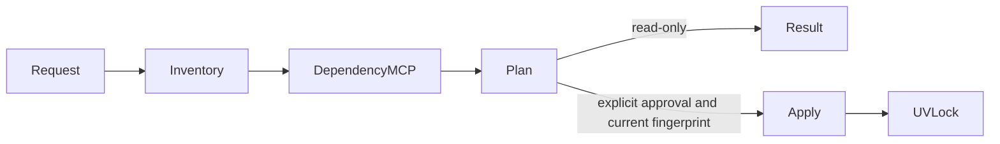

# Python-upgrade workflow

## Purpose

This package inventories one uv-managed Python project, checks each direct
locked dependency against a requested Python major/minor version, and returns a
deterministic upgrade plan. Planning is read-only. Applying a plan is an
explicitly authorized operation that updates `pyproject.toml` and regenerates
`uv.lock`; it refuses stale or incomplete evidence.

## Architecture

[`models.py`](models.py) defines immutable project inventory, dependency
assessment, plan, and outcome contracts. [`ports.py`](ports.py) defines the
provider-neutral project source. [`workflow.py`](workflow.py) owns stage order,
bounded dependency concurrency, package-selection policy, stale-plan checks,
and the approval boundary. [`__init__.py`](__init__.py) exports the public API.

The local project implementation is
[`../../../../../adapters/python_upgrade/local.py`](../../../../../adapters/python_upgrade/local.py).
PyPI access remains behind `DependencyIntelligenceSource`; the production MCP
composition uses its dedicated MCP adapter.

The MCP tool invocation is the root operation span. Inventory, analysis, plan,
and apply lifecycle events carry the same correlation ID through
`WorkflowRunner`. Dependency capability calls are child adapter operations;
the dependency server owns its provider call. Only operation names, workflow
identity, status, and bounded counts are eligible for telemetry. Project file
contents, package descriptions, credentials, and arbitrary provider payloads
are excluded.

## Dependencies

- Internal packages: `workflow_harness` for stage and authorization
  enforcement, `dependency_intelligence` for provider-neutral package facts,
  and immutable contracts in this package.
- Injected protocols: `PythonProjectSource` and
  `DependencyIntelligenceSource`.
- External services and SDKs: PyPI through the dependency-intelligence MCP
  server; `uv` for lock regeneration during an approved apply.
- Runtime configuration: an existing `pyproject.toml`; `uv.lock` is optional
  for planning but missing locked versions are reported as unknown.
- Telemetry: the shared OpenTelemetry API and composition-root SDK
  configuration. W3C parent context enters at MCP; bounded workflow operations
  remain children of that invocation.

## Workflow

1. Validate a stable `major.minor` target and `max_parallel` from one through
   five.
2. Read `pyproject.toml`, optional `uv.lock`, direct requirements, locked
   versions, and a SHA-256 fingerprint over both files.
3. Require the target to raise the current `>=` Python minimum.
4. Analyze direct dependencies with at most five concurrent workers. For each
   dependency, read releases and exact locked-release compatibility.
5. Build sorted blockers, unknowns, and candidate dependency updates. Missing
   `Requires-Python` metadata remains unknown rather than being treated as
   compatible.
6. Return the read-only plan and fingerprint.
7. The separate apply tool reruns all prior stages and authorizes only the
   `apply` stage. It rejects stale fingerprints, blockers, unknowns, and
   dependency updates requiring review.
8. The local adapter changes the Python minimum and runs `uv lock`. Any lock
   failure restores both files before returning an error.

Invalid project metadata, duplicate dependencies, ambiguous lock versions,
provider failures, unsupported Python ranges, and unsafe apply states fail
immediately. Planning has no side effects. Apply changes only
`pyproject.toml` and `uv.lock`.

## Verification

Focused tests cover inventory parsing, fingerprint changes, lock rollback,
target validation, bounded parallelism, compatible plans, blockers, unknowns,
dependency-update review, stale-plan rejection, workflow authorization, and
MCP output. The Python-upgrade benchmark includes safe, blocked, and unknown
compatibility cases. Shared workflow tests verify correlation and stage
lifecycle ordering; telemetry output excludes source payloads.

## Change policy

Update this document when stages, concurrency limits, compatibility policy,
project files, mutation rules, provider boundaries, MCP tools, telemetry, or
benchmark cases change.
