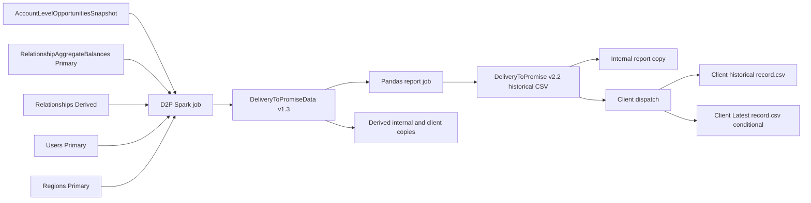

# Delivery to Promise reporting lineage

The first endpoint is the standard DeliveryToPromise report v2.2, generated from DeliveryToPromiseData v1.3. The user selected exact reporting-row prediction for one pinned input snapshot. Other Products and Treasury are separate report variants and remain outside this first executable slice.

The source inventory contains 43 dataset/job nodes, 55 edges and the 50-column report projection. The [graph](delivery-to-promise-graph.json) records control dependencies separately from data dependencies; the [source receipt](delivery-to-promise-sources.json) pins 39 files by repository commit and SHA256. These are investigation artifacts, not published executable formal-method contracts. Their status is unknown and predictionReady is false.

## Source pins and scope

| Repository | Commit | Purpose |
| --- | --- | --- |
| di-pipelines | `fd9d9b74b53946150a01ed68fb87e4ffa4b7bc1e` | DAGs, jobs, metadata, shared helpers, dispatch and existing fixture tests |
| di-pyjobs | `32fbfc493d7f039def61c157e579caf24288db48` | Runner, serialization, uploader and library path dependencies |

The source receipt hashes exact Git blobs at these revisions. It does not claim these revisions are the deployed builds for a future validation run. Existing sibling working-tree changes are excluded from the pinned source reads. Evidence identifiers below resolve to paths, commits and byte hashes in that receipt.

## Reporting path

The main D2P job consumes primary relationship aggregates directly. Core deposit and treasury contributions have already been aggregated into that input; the main job does not declare CoreDepositAccounts as a direct input. The upstream RA computation is an external boundary until its source program and inputs are included.

## Expected job interfaces

| Direct D2P input | Declared major | Selection policy | Metadata identity columns |
| --- | --- | --- | --- |
| AccountLevelOpportunitiesSnapshot | 1 | RUN_DATE | OpportunityId, ScenarioId, AccountId, WriteTimePartition |
| RelationshipAggregateBalances | 1 | ALL_DATES | RelationshipNewId, RaRunId |
| Relationships Derived | 3 | ALL_DATES | RelationshipExternalId, DatePartition |
| Users Primary | 2 | ALL_DATES | UserId, DatePartition |
| Regions Primary | 1 | ALL_DATES | RegionId, DatePartition |

`derived_job` declares these five inputs. It applies downloader as-of filtering and latest-minor selection before transforming them. Code metadata currently names latest versions 1.20, 1.3, 3.6, 2.1 and 1.0 respectively, but those constants do not establish the physical versions read by a specific run. The declarations leave the input minor versions unset, so the resolved versions require snapshot evidence.

`derived_schema` defines DeliveryToPromiseData v1.3 as CSV, with DatePartition and metadata identity columns OpportunityId, OpportunityLastModified, DepositType and DatePartition. The Spark uploader projects and casts using metadata; uploader-added date columns and their values belong in the executable contract.

`report_job` reads DeliveryToPromiseData major 1 for RUN_DATE and performs its own minor-version selection. It returns 50 selected and renamed columns after formatting OpportunityLastModified and LastRaRunDate. `report_schema` defines report v2.2. The graph preserves every literal FINAL_COLS mapping. Metadata identity columns are selection configuration, not proof of output uniqueness.

## Orchestration

The main graph declares the D2P task group downstream of high-quality Relationships and account-level Opportunities. The reporting group is downstream of the D2P group. Within the D2P group, the internal and client derived copies follow the Spark job. Within the report group, internal copy and client dispatch both follow the Pandas report job. See `dag`, `derived_group` and `report_group`.

Task-group dependencies must be expanded through actual roots/leaves and trigger rules for a chosen invocation. In particular, the report group's prerequisite is the upstream task group, so replacing that relationship with only a direct Spark-job prerequisite could lose copy/failure gating. The graph labels these declarations as task_group with expansion pending.

The source assigns Spark compute to the D2P transform and batch compute to the Pandas report, copy and dispatch tasks. Client-specific Spark/resource overrides, activity configuration and package archive resolution must be bound to the selected runtime.

## Upstream expansion

- AccountLevelOpportunitiesHistory declares Primary Opportunities major 2, Users major 2, optional DepositProducts/CommercialLoanProducts/MasterCommitmentProducts major 1, latest Enumerations major 1, and optional Derived CoreTreasuryProductAssumptionsData major 1. Normal selection is RUN_DATE except Enumerations; backfill changes non-enumeration inputs to ALL_DATES. The job expands nested scenarios/accounts and uses inherited change-data writer behavior. See `history_job` and `opportunity_group`.
- AccountLevelOpportunitiesSnapshot is produced from AccountLevelOpportunitiesHistory by OpportunitiesSnapshotRunner. Normal incremental processing reads the prior snapshot using LATEST_DATE_EXCLUSIVE; backfill requests can trigger a full history reconstruction. A normal run therefore cannot be predicted from new history alone. See `opportunity_snapshot_job`, `snapshot_runner` and `opportunity_group`.
- Relationships Derived uses Primary Relationships, RelationshipFinancialStatements, RelationshipAggregateBalances, Users and Regions, plus optional Primary CoreTreasuryAccounts and Derived CoreAccountFinancialStatements. Its shared DerivedRaRunner also reads the existing sink to select work. Optional inputs can change values or cause an early exit, so their presence/absence is part of the pinned context. See `relationship_job` and `ra_runner`.
- RelationshipAggregateBalances is ingested from OperationalRA's DatabaseOutput/dbStagingDeliveryToPromiseAggregates.csv through a schema-handling move job. The declared historical output is primary v1.3. See `ra_group` and `aggregate_ingest`.
- Derived CoreAccountFinancialStatements declares Primary CoreAccountFinancialStatements, latest Enumerations, LoanFinancialStatementBreakdown, and optional Deposit/Other/TreasuryFinancialStatementBreakdown datasets. It also inherits prior-sink work selection. See `cafs_job` and `ra_runner`.
- Derived CoreTreasuryProductAssumptionsData declares latest Primary TreasuryAssumptions major 1, chooses latest effective products, expands nested settings and cost tiers, and removes duplicates. Its invocation depends on the resolved client/resource branch. See `treasury_assumptions_job`, `treasury_assumptions_group` and `dag`.
- Original acquisition of Primary data and RA computation are external to the selected primary-to-reporting boundary. The source graph includes the aggregate ingestion origin for provenance, but exact prediction can begin at its pinned Primary output. Complete upstream schemas, dynamic branch selection, nested helpers and runner/writer semantics remain unresolved; identifying producer interfaces is not a closed executable program.

Prior state is recorded in job.state_dependencies with temporal selection roles, separate from ordinary producer edges. A future evaluator must resolve those roles to concrete snapshot identities before topological composition; they are not optional because they are outside the displayed data-flow arrows.

## Transformation rules recovered from source inspection

These rules identify what AST lowering must preserve; no executable AST compiler or predictor has been implemented yet.

| Stage | Observed behavior | Required boundary checks |
| --- | --- | --- |
| Opportunity filter | Positive other income OR positive deposit average balance; ClosedWon; not deleted; Pipeline scenario; non-null relationship | SQL null logic and empty-input exit |
| History window | DaysSinceClose is at least 0 and strictly less than 1096 | Date coercion, timezone and exact endpoints |
| Opportunity representative | row_number by maximum OppDepositsPromisedAllTypes per OpportunityId | Tied values must be equivalent for projected output or prediction remains ambiguous |
| Deposit extraction | AccountType Deposit; maturity uses add_months of origination date and term | Calendar-month behavior and nulls |
| Timed deposits | Retain non-timed deposits or those whose maturity is at least PricingDate | Preserve predicate behavior when dates/types are null |
| Treasury normalization | TreasuryZeroInterestDemand to ZeroInterestDemand; TreasuryInterestBearingDemand to InterestBearingDemand; other types retained | Unknown types are not assigned an invented bucket |
| Core reshaping | stack five balance values into four deposit-type buckets, then retain Balance greater than 0 | Both conventional and treasury interest-bearing contributions share a bucket |
| Core latest selection | rank by DatePartition per relationship/type, preserving tied contributions | Positive filtering occurs before latest selection; zero/latest history must be tested |
| Time-series weighting | Sum balances by relationship/type/date; DaysInEffect uses lag over DaysAgo | Preserve the source's weights rather than imposing new interval clipping |
| Delivery start | First core date strictly after close and at most 36 times 30 days after close | Upper bound inclusive for start-stat candidate set |
| Window statistics | 6, 12, 24 and 36 times 30-day windows; core date strictly after close and strictly before upper bound | These are fixed day windows, not calendar-month intervals |
| Weighted average | sum(balance times DaysInEffect) divided by sum(DaysInEffect), grouped by opportunity/type | Double arithmetic, zero denominators and runtime ANSI behavior |
| Join enrichment | Latest Users inner-join latest Regions; opportunity left-joins owner, relationship and core features | Duplicates, unmatched keys, null keys and row multiplication |
| String handling | Replace selected special characters in relationship/opportunity names | Preserve exact mapping, regex and serialization effects |
| Report | Pandas timestamp/date formatting followed by 50-column projection | NA conversion, timestamp formats and CSV read/write coercion |

The job also exits if relevant core data is empty, no opportunity remains, or the maximum aggregate date is older than the maximum relationship date. These branches affect whether a report exists and belong in the formal program. The opportunity lookback filter uses CloseDate; nearby comments do not override the executable predicate.

The downloader helper extracts minor versions into string expressions before ranking. Version-selection behavior must be reproduced from the pinned implementation and tested with the actual available versions; do not silently substitute an assumed numeric comparison. See `spark_download_helpers` and `pandas_download_helpers`.

Existing unit fixtures cover opportunity filtering, maturity calculation, time-series construction, balance reshaping and treasury normalization (`derived_tests`). They are useful starting evidence, not full-path output validation; they were inspected as source and were not run in this investigation.

## Delivery effects

The report group writes historical DeliveryToPromise v2.2 through DataStudioLibraryHistoricalV2 with chunkSize -1. PandasRunner configures the framework chunker/uploader; Pandas CSV serialization uses index=False. Final writer behavior, initial target state and deployment dependencies still need complete rules. See `report_group`, `pandas_runner`, `chunk` and `upload`.

Client dispatch expects exactly one source CSV. Zero files produces a no-data exit; multiple files raise MoreThanOneDatafeedRecord. With a provisioned output resource, it replaces the selected historical record.csv. It also replaces Latest/record.csv only when backfill is false and the captured UTC clock is no more than 48 hours after window_start. Missing client storage exits without writing. See `dispatch_job` and `library_paths`.

Thus one pinned historical report may exist while the client Latest output remains unchanged. Capture the clock, backfill flag, storage presence and existing target state whenever predicting delivery effects.

## Synthetic validation selection

The user replaced the live-date requirement with invented data covering known ways data can disappear. The [synthetic suite](synthetic/README.md) provides 163 concrete scenarios and a complete 50-column reporting oracle at a fixed 2026-10-29T05:00:00Z clock. Fixtures include negative cases, matching positive controls, retained rows with missing measures, explicit exits/errors and ambiguous ranking. No live client records are needed. Source-function validation and physical/orchestration validation have separate coverage boundaries.

## Optional later live validation

The reporting endpoint and client are selected: First Example Bank (`99b9412b-70fd-4221-8431-d1b3934889ec`). The Resource Discovery MCP returned one identity from its API-derived local index. [Client-selection evidence](delivery-to-promise-client.json) records the lookup source and two bounded US production OMS searches, which found no matching D2P metadata between 2026-09-29T20:42:29Z and 2026-10-29T20:42:29Z. This does not establish whether retained report files exist. The reporting window, execution environment and physical data versions remain unspecified. Before producing expected rows, bind:

1. Environment, full window_start UTC and successful run/deployment identity for the selected client.
2. Exact source file inventories/versions for all five direct inputs and all upstream inputs needed for a primary-to-reporting prediction.
3. Prior opportunity snapshot and prior Relationships sink for normal incremental replay, or explicit full-reconstruction semantics.
4. Effective runtime/session/library settings, date/time formats, backfill state and any client overrides.
5. Observed historical report version and, if delivery is in scope, target-state snapshots and dispatch clock/resource state.

Live validation is optional follow-up to the synthetic suite. The suite uses selected AST definitions from pinned source and intercepts cloud dependencies; its result records precisely which functions and synthetic expectations were checked. The graph retains unknown status for unresolved full-path behavior, and no real client dataset is validated by synthetic agreement.
